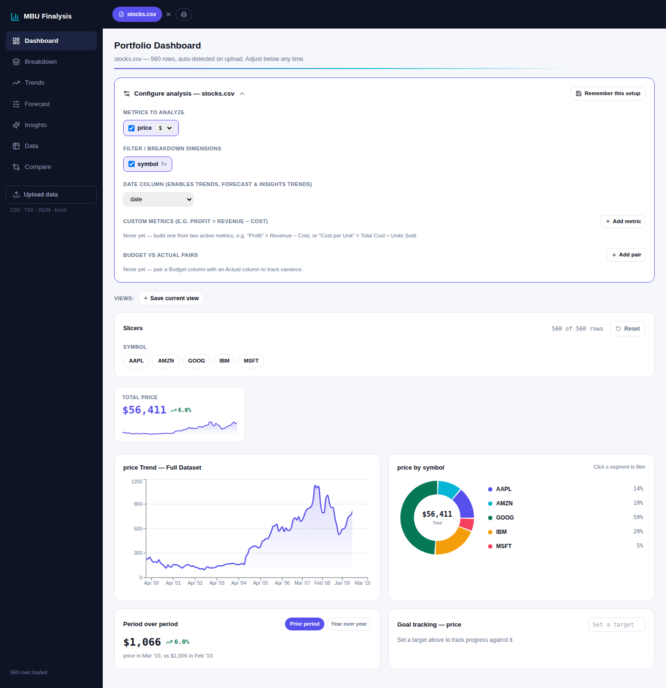
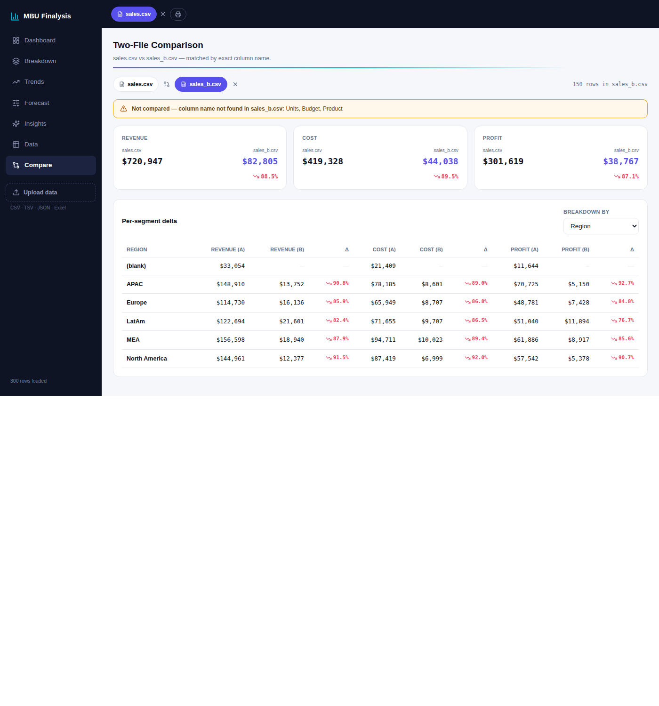
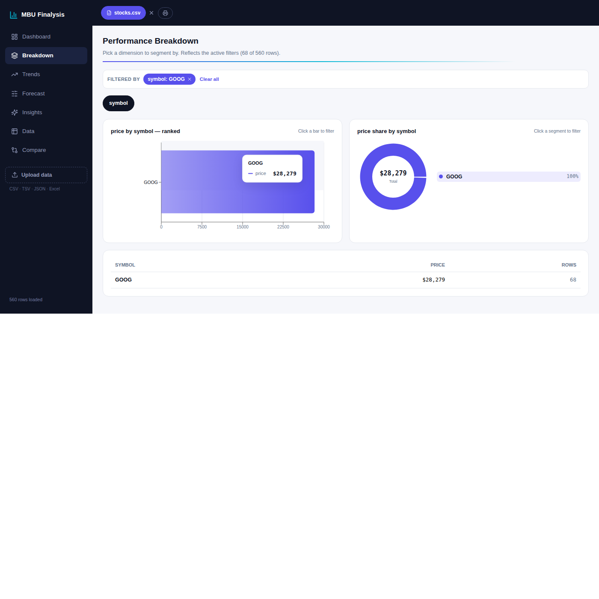

# MBU Finalysis

A domain-agnostic, browser-based financial/data analytics workspace. Upload a spreadsheet, review detected column names and types, then explore KPIs, breakdowns, trends, forecasts, comparisons, and pattern-detection insights. No backend or account is needed. Analysis runs in your browser.

**[Live demo](https://claude.ai/artifact/NpRZvwbCbPvqSDbnH1csj8)**



## Features

**Dashboard** — auto-detected KPI cards with period-over-period delta badges (prior period or year-over-year, toggled), a trend sparkline, a donut breakdown by your primary dimension, Power BI-style multi-select slicers, and goal tracking against a target you set.

**Breakdown** — a ranked bar chart and donut for any dimension, a full metrics table per segment, click-to-filter drill-through (click a bar or slice anywhere and every tab reflects that filter), and a head-to-head "compare two segments" table.

**Trends** — line or area charts over time for every active metric, with the ability to hide/show individual series and a brush control to zoom into a date range.

**Forecast** — growth scenarios (conservative/base/aggressive, or a custom rate) projected from your own historical trend, goal-seek ("what growth rate do I need to hit X by date Y"), and a sensitivity grid that varies two assumptions of a calculated metric at once. A rolling one-month backtest reports historical error when enough consecutive observations exist. Scenarios are illustrative, especially with short or irregular histories.

**Insights** — fully offline pattern detection: strengths and pain points per dimension, correlations between numeric fields, statistical outlier detection, configurable threshold alerts, and a data quality report (duplicates, missing values, unparseable dates, negative values). See [AI features](#ai-features-optional) below for the two features that need a live API call.

**Data** — a searchable, sortable, paginated table of every row, with CSV export.

**Compare** — upload a second file and compare its totals against your primary dataset, matched by exact column name only (no fuzzy matching, so what's compared is always auditable). Flags unmatched columns, shows side-by-side totals with deltas, and a per-segment delta table.




Every configuration (which metrics/dimensions are on, custom calculated metrics, budget-vs-actual pairs, saved views) can be remembered per file-shape via `localStorage`, so re-uploading a similarly-shaped file restores your setup automatically.

The import review lets you rename columns and choose number, date, or category handling, including day-first or month-first dates. Numbers with common currency symbols, thousands separators, parentheses, and percent signs are parsed; the preview counts values that cannot be parsed before you proceed. Each metric can use a sum, average, count of nonblank values, minimum, or maximum. CSV exports neutralize spreadsheet formulas in text cells.

## Getting started

```bash
npm install
npm run dev
```

Open the printed local URL and drop in a CSV, TSV, JSON, or Excel (`.xlsx`/`.xls`) file.

### Build

```bash
npm run build
```

Run the calculation regression tests with `npm test`. The GitHub Pages workflow runs tests before building.

This produces a single self-contained `dist/index.html`; the build script inlines Vite's generated script and stylesheet. You can drop that file on GitHub Pages, a static file host, or open it locally.

### Deploying to GitHub Pages

```bash
npm run build
# then publish dist/index.html as the root of your gh-pages branch,
# or point Pages at an action that runs `npm run build` and deploys dist/
```

Since it's a single file with everything inlined, there's no routing or asset-path configuration to worry about.

## AI features (optional)

Two features on the Insights tab — **Generate AI insights** (a narrative summary) and **Ask a question** (a chat-style Q&A box) — call `api.anthropic.com` directly from the browser with a plain-text prompt built from your data's aggregated totals (never raw rows).

As shipped, `src/main.jsx` sets a flag that makes both fail gracefully with an explanatory message instead of firing that request, because **this is a static frontend with no backend** — there's nowhere safe to hold an API key. Anything shipped in client-side JavaScript is visible to every visitor, so an API key pasted directly into this code would be exposed to anyone who opens dev tools.

Everything else — the rule-based pattern detection, correlations, outliers, and threshold alerts on that same tab — runs fully offline and is unaffected.

If you want these two working for real, you'll need your own lightweight backend (a serverless function is enough) that holds your Anthropic API key, proxies the request, and returns the response — then point the two `fetch` calls in `src/App.jsx` (search for `api.anthropic.com`) at your proxy instead, and remove the `window.__ARTIFACT_BUILD__` flag in `src/main.jsx`.

## Tech stack

- [React 18](https://react.dev/) + [Vite 8](https://vite.dev/)
- [Recharts](https://recharts.org/) for charts
- [PapaParse](https://www.papaparse.com/) (CSV/TSV) and [SheetJS](https://sheetjs.com/) (Excel) for parsing
- SheetJS is installed from its [official distribution](https://docs.sheetjs.com/docs/getting-started/installation/frameworks/) because the npm registry package is outdated.
- A small responsive stylesheet in `src/tw-built.css` plus inline styles
- [Lucide](https://lucide.dev/) icons

### Styling

The few responsive grid and visibility classes used by the app are defined directly in `src/tw-built.css`. Add new class rules there when adding responsive layouts.

## Project structure

```
├── index.html
├── src/
│   ├── main.jsx        # entry point — mounts the app, localStorage shim
│   ├── App.jsx          # the entire application (single component file)
│   └── tw-built.css      # small responsive stylesheet
├── vite.config.js
├── scripts/inline-build.mjs
├── tests/analysis.test.cjs
└── docs/screenshots/
```

## Data & privacy

Nothing you upload ever leaves your browser. Parsing, aggregation, and charting all happen client-side; there is no server this app talks to (aside from the two optional AI features above, which are disabled by default as shipped).

## License

MIT — see [LICENSE](LICENSE).
